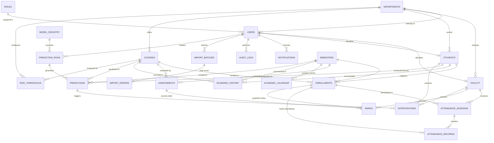

# AcadRisk AI: Database Architecture & Design Specification

## 1. Relational Database Overview

AcadRisk AI utilizes a normalized relational schema hosted on **MySQL 8** (with resilient local SQLite fallback). The database models the end-to-end operational and analytical lifecycle of higher educational institutions: from core organizational entities (Departments, Faculty, Students, Courses, Semesters) to real-time transactional records (Enrollments, Attendance, Assessments, Marks), machine learning governance (Model Registry, Prediction Runs, Predictions), student support workflows (Interventions, Notifications), and administrative governance (Audit Logs, Import Batches, Risk Thresholds).

### Design Principles:
1. **Third Normal Form (3NF) Compliance:** Elimination of insertion, update, and deletion anomalies through functional dependency analysis.
2. **Referential Integrity:** Complete foreign key coverage with explicit `ON DELETE CASCADE` or `ON DELETE RESTRICT` constraints to maintain parent-child consistency.
3. **Domain & Business Constraints:** Strict `CHECK` constraints on numerical domains (e.g., marks between 0 and maximum marks, percentages between 0 and 100, valid date sequences).
4. **Data Isolation & Duplicate Prevention:** Compound `UNIQUE` constraints preventing duplicate enrollments, duplicate attendance logging per session, or duplicate mark entries.
5. **Traceability & Auditing:** Comprehensive audit logging powered by native database triggers and application transaction interceptors.

---

## 2. Complete Entity-Relationship (ER) Diagram

---

## 3. Detailed Table Specifications (23 Tables)

### Table 1: `roles`
Stores application authorization roles.
- `role_id` (INT, PK, Auto-Increment)
- `role_name` (VARCHAR(50), NOT NULL, UNIQUE) — e.g., 'ADMIN', 'FACULTY', 'STUDENT'
- `description` (VARCHAR(255))

### Table 2: `users`
Core user credentials and account states.
- `user_id` (INT, PK, Auto-Increment)
- `role_id` (INT, FK -> roles.role_id, NOT NULL)
- `username` (VARCHAR(100), NOT NULL, UNIQUE)
- `email` (VARCHAR(150), NOT NULL, UNIQUE)
- `password_hash` (VARCHAR(255), NOT NULL) — PBKDF2/SHA-256
- `account_status` (VARCHAR(20), DEFAULT 'ACTIVE', CHECK in ('ACTIVE', 'SUSPENDED', 'PENDING'))
- `created_at` (DATETIME, DEFAULT CURRENT_TIMESTAMP)

### Table 3: `departments`
Academic departments and divisions.
- `department_id` (INT, PK, Auto-Increment)
- `department_name` (VARCHAR(100), NOT NULL, UNIQUE)
- `department_code` (VARCHAR(20), NOT NULL, UNIQUE) — e.g., 'CSE', 'ECE'
- `description` (TEXT)

### Table 4: `faculty`
Faculty member profiles and affiliations.
- `faculty_id` (INT, PK, Auto-Increment)
- `user_id` (INT, FK -> users.user_id, UNIQUE, ON DELETE CASCADE)
- `department_id` (INT, FK -> departments.department_id, ON DELETE RESTRICT)
- `faculty_name` (VARCHAR(100), NOT NULL)
- `designation` (VARCHAR(100)) — e.g., 'Associate Professor'
- `contact_information` (VARCHAR(255))

### Table 5: `students`
Student demographic and admission records.
- `student_id` (INT, PK, Auto-Increment)
- `user_id` (INT, FK -> users.user_id, UNIQUE, ON DELETE CASCADE)
- `department_id` (INT, FK -> departments.department_id, ON DELETE RESTRICT)
- `registration_number` (VARCHAR(50), NOT NULL, UNIQUE)
- `student_name` (VARCHAR(100), NOT NULL)
- `date_of_birth` (DATE)
- `admission_year` (INT, NOT NULL, CHECK > 2000)
- `semester` (INT, NOT NULL, CHECK between 1 and 12)
- `contact_information` (VARCHAR(255))

### Table 6: `courses`
Curricular offerings and credit weights.
- `course_id` (INT, PK, Auto-Increment)
- `department_id` (INT, FK -> departments.department_id, ON DELETE RESTRICT)
- `course_code` (VARCHAR(20), NOT NULL, UNIQUE) — e.g., 'CS301'
- `course_name` (VARCHAR(150), NOT NULL)
- `credits` (INT, NOT NULL, CHECK between 1 and 10)
- `description` (TEXT)

### Table 7: `semesters`
Academic calendar terms.
- `semester_id` (INT, PK, Auto-Increment)
- `semester_name` (VARCHAR(50), NOT NULL) — e.g., 'Fall 2026'
- `academic_year` (VARCHAR(20), NOT NULL) — e.g., '2026-2027'
- `start_date` (DATE, NOT NULL)
- `end_date` (DATE, NOT NULL, CHECK end_date >= start_date)
- `status` (VARCHAR(20), DEFAULT 'ACTIVE', CHECK in ('ACTIVE', 'COMPLETED', 'UPCOMING'))

### Table 8: `academic_calendar`
Milestones, assessment periods, and institutional deadlines.
- `calendar_id` (INT, PK, Auto-Increment)
- `semester_id` (INT, FK -> semesters.semester_id, ON DELETE CASCADE)
- `event_name` (VARCHAR(150), NOT NULL)
- `event_date` (DATE, NOT NULL)
- `description` (TEXT)

### Table 9: `enrollments`
Course registrations mapping students to courses per semester.
- `enrollment_id` (INT, PK, Auto-Increment)
- `student_id` (INT, FK -> students.student_id, ON DELETE CASCADE)
- `course_id` (INT, FK -> courses.course_id, ON DELETE CASCADE)
- `semester_id` (INT, FK -> semesters.semester_id, ON DELETE CASCADE)
- `enrollment_date` (DATE, DEFAULT CURRENT_DATE)
- `enrollment_status` (VARCHAR(20), DEFAULT 'ENROLLED', CHECK in ('ENROLLED', 'DROPPED', 'COMPLETED'))
- **Constraint:** `UNIQUE (student_id, course_id, semester_id)`

### Table 10: `attendance_sessions`
Scheduled lecture, lab, and tutorial sessions.
- `session_id` (INT, PK, Auto-Increment)
- `enrollment_id` (INT, FK -> enrollments.enrollment_id, ON DELETE CASCADE)
- `faculty_id` (INT, FK -> faculty.faculty_id, ON DELETE RESTRICT)
- `session_date` (DATE, NOT NULL)
- `session_type` (VARCHAR(50), DEFAULT 'LECTURE', CHECK in ('LECTURE', 'LAB', 'TUTORIAL'))

### Table 11: `attendance_records`
Individual student presence status per session.
- `attendance_id` (INT, PK, Auto-Increment)
- `session_id` (INT, FK -> attendance_sessions.session_id, ON DELETE CASCADE)
- `enrollment_id` (INT, FK -> enrollments.enrollment_id, ON DELETE CASCADE)
- `attendance_status` (VARCHAR(20), NOT NULL, CHECK in ('PRESENT', 'ABSENT', 'LATE', 'EXCUSED'))
- `recorded_at` (DATETIME, DEFAULT CURRENT_TIMESTAMP)
- **Constraint:** `UNIQUE (session_id, enrollment_id)`

### Table 12: `assessments`
Assessment configurations (Midterm, Quiz, Final Exam, Lab).
- `assessment_id` (INT, PK, Auto-Increment)
- `course_id` (INT, FK -> courses.course_id, ON DELETE CASCADE)
- `semester_id` (INT, FK -> semesters.semester_id, ON DELETE CASCADE)
- `assessment_name` (VARCHAR(100), NOT NULL)
- `assessment_type` (VARCHAR(50), NOT NULL, CHECK in ('MIDTERM', 'QUIZ', 'ASSIGNMENT', 'FINAL_EXAM', 'LAB'))
- `maximum_marks` (DECIMAL(5,2), NOT NULL, CHECK maximum_marks > 0)
- `assessment_date` (DATE)

### Table 13: `marks`
Student assessment marks obtained.
- `mark_id` (INT, PK, Auto-Increment)
- `assessment_id` (INT, FK -> assessments.assessment_id, ON DELETE CASCADE)
- `enrollment_id` (INT, FK -> enrollments.enrollment_id, ON DELETE CASCADE)
- `obtained_marks` (DECIMAL(5,2), NOT NULL, CHECK obtained_marks >= 0)
- `recorded_by` (INT, FK -> faculty.faculty_id, ON DELETE SET NULL)
- `recorded_at` (DATETIME, DEFAULT CURRENT_TIMESTAMP)
- **Constraint:** `UNIQUE (assessment_id, enrollment_id)`

### Table 14: `academic_history`
Summative transcript grades and SGPA records.
- `history_id` (INT, PK, Auto-Increment)
- `student_id` (INT, FK -> students.student_id, ON DELETE CASCADE)
- `semester_id` (INT, FK -> semesters.semester_id, ON DELETE RESTRICT)
- `course_id` (INT, FK -> courses.course_id, ON DELETE RESTRICT)
- `final_grade` (VARCHAR(5), NOT NULL)
- `grade_point` (DECIMAL(4,2), NOT NULL, CHECK between 0.00 and 10.00)
- `credits` (INT, NOT NULL, CHECK > 0)
- `result_status` (VARCHAR(20), DEFAULT 'PASS', CHECK in ('PASS', 'FAIL', 'WITHDRAWN'))
- **Constraint:** `UNIQUE (student_id, semester_id, course_id)`

### Table 15: `import_batches`
Bulk CSV/Excel upload tracking metadata.
- `batch_id` (INT, PK, Auto-Increment)
- `imported_by` (INT, FK -> users.user_id, ON DELETE SET NULL)
- `file_name` (VARCHAR(255), NOT NULL)
- `file_type` (VARCHAR(50))
- `import_type` (VARCHAR(50), NOT NULL) — e.g., 'STUDENT', 'MARKS', 'ATTENDANCE'
- `total_records` (INT, DEFAULT 0)
- `successful_records` (INT, DEFAULT 0)
- `failed_records` (INT, DEFAULT 0)
- `import_status` (VARCHAR(20), DEFAULT 'COMPLETED')
- `imported_at` (DATETIME, DEFAULT CURRENT_TIMESTAMP)

### Table 16: `import_errors`
Line-by-line validation errors during bulk import.
- `error_id` (INT, PK, Auto-Increment)
- `batch_id` (INT, FK -> import_batches.batch_id, ON DELETE CASCADE)
- `row_number` (INT, NOT NULL)
- `error_description` (TEXT, NOT NULL)

### Table 17: `model_registry`
Metadata and evaluation metrics of trained ML models.
- `model_id` (INT, PK, Auto-Increment)
- `model_name` (VARCHAR(100), NOT NULL)
- `algorithm` (VARCHAR(100), NOT NULL)
- `model_version` (VARCHAR(50), NOT NULL)
- `dataset_source` (VARCHAR(255))
- `accuracy` (DECIMAL(5,4), NOT NULL)
- `precision` (DECIMAL(5,4), NOT NULL)
- `recall` (DECIMAL(5,4), NOT NULL)
- `f1_score` (DECIMAL(5,4), NOT NULL)
- `model_path` (VARCHAR(255), NOT NULL)
- `training_date` (DATETIME, DEFAULT CURRENT_TIMESTAMP)
- `model_status` (VARCHAR(20), DEFAULT 'ACTIVE', CHECK in ('ACTIVE', 'CANDIDATE', 'DEPRECATED'))

### Table 18: `prediction_runs`
Audit record of batch inference executions.
- `run_id` (INT, PK, Auto-Increment)
- `model_id` (INT, FK -> model_registry.model_id, ON DELETE RESTRICT)
- `initiated_by` (INT, FK -> users.user_id, ON DELETE SET NULL)
- `start_time` (DATETIME, DEFAULT CURRENT_TIMESTAMP)
- `completion_time` (DATETIME)
- `total_predictions` (INT, DEFAULT 0)
- `run_status` (VARCHAR(20), DEFAULT 'SUCCESS')

### Table 19: `predictions`
Student-course risk classification and predicted score.
- `prediction_id` (INT, PK, Auto-Increment)
- `run_id` (INT, FK -> prediction_runs.run_id, ON DELETE CASCADE)
- `student_id` (INT, FK -> students.student_id, ON DELETE CASCADE)
- `course_id` (INT, FK -> courses.course_id, ON DELETE CASCADE)
- `semester_id` (INT, FK -> semesters.semester_id, ON DELETE CASCADE)
- `predicted_marks` (DECIMAL(5,2))
- `risk_category` (VARCHAR(20), NOT NULL, CHECK in ('LOW', 'MEDIUM', 'HIGH'))
- `risk_probability` (DECIMAL(5,4), NOT NULL, CHECK between 0.0000 and 1.0000)
- `prediction_date` (DATETIME, DEFAULT CURRENT_TIMESTAMP)

### Table 20: `interventions`
Remedial actions and counseling workflows assigned to students.
- `intervention_id` (INT, PK, Auto-Increment)
- `prediction_id` (INT, FK -> predictions.prediction_id, ON DELETE SET NULL)
- `student_id` (INT, FK -> students.student_id, ON DELETE CASCADE)
- `faculty_id` (INT, FK -> faculty.faculty_id, ON DELETE RESTRICT)
- `intervention_type` (VARCHAR(50), NOT NULL) — e.g., 'ACADEMIC_COUNSELING', 'TUTORIAL', 'PARENT_MEETING'
- `intervention_description` (TEXT, NOT NULL)
- `follow_up_date` (DATE)
- `intervention_status` (VARCHAR(20), DEFAULT 'PLANNED', CHECK in ('PLANNED', 'IN_PROGRESS', 'COMPLETED', 'CANCELLED'))
- `outcome` (TEXT)

### Table 21: `notifications`
Targeted user alerts and automated triggers.
- `notification_id` (INT, PK, Auto-Increment)
- `user_id` (INT, FK -> users.user_id, ON DELETE CASCADE)
- `notification_type` (VARCHAR(50), NOT NULL) — e.g., 'HIGH_RISK_ALERT', 'LOW_ATTENDANCE'
- `message` (TEXT, NOT NULL)
- `read_status` (BOOLEAN, DEFAULT FALSE)
- `created_at` (DATETIME, DEFAULT CURRENT_TIMESTAMP)

### Table 22: `audit_logs`
Immutable database change logs.
- `log_id` (INT, PK, Auto-Increment)
- `user_id` (INT, FK -> users.user_id, ON DELETE SET NULL)
- `action_type` (VARCHAR(50), NOT NULL) — 'INSERT', 'UPDATE', 'DELETE'
- `table_name` (VARCHAR(100), NOT NULL)
- `record_id` (INT, NOT NULL)
- `old_values` (JSON)
- `new_values` (JSON)
- `timestamp` (DATETIME, DEFAULT CURRENT_TIMESTAMP)

### Table 23: `risk_thresholds`
Course or department-specific risk boundary overrides.
- `threshold_id` (INT, PK, Auto-Increment)
- `department_id` (INT, FK -> departments.department_id, ON DELETE CASCADE)
- `course_id` (INT, FK -> courses.course_id, ON DELETE CASCADE)
- `high_risk_threshold` (DECIMAL(5,2), DEFAULT 50.00)
- `medium_risk_threshold` (DECIMAL(5,2), DEFAULT 70.00)
- `low_risk_threshold` (DECIMAL(5,2), DEFAULT 85.00)
- `updated_at` (DATETIME, DEFAULT CURRENT_TIMESTAMP)

---

## 4. Normalization Analysis (1NF, 2NF, 3NF)

### First Normal Form (1NF) Compliance
- **Atomic Values:** Every attribute in every relation contains solely single, indivisible values. For example, student phone numbers or contact details are stored as single atomic strings, and multi-valued historical enrollments are factored into a dedicated `enrollments` bridge table.
- **Unique Records & Primary Keys:** Every table is assigned an explicit, non-null Primary Key (`role_id`, `user_id`, `student_id`, etc.).
- **Order Invariance:** No business logic depends on the physical ordering of tuples or columns.

### Second Normal Form (2NF) Compliance
- 2NF requires 1NF compliance and that **all non-prime attributes are fully functionally dependent on the whole candidate key** (no partial functional dependencies on composite candidate keys).
- In composite relationship tables such as `enrollments (student_id, course_id, semester_id)` and `marks (assessment_id, enrollment_id)`:
  - Synthetic surrogate keys (`enrollment_id`, `mark_id`) are chosen as primary keys.
  - The compound business keys are enforced using secondary `UNIQUE` constraints.
  - Non-prime attributes such as `obtained_marks` depend strictly on both the assessment and the specific enrollment (`(assessment_id, enrollment_id) -> obtained_marks`). There are zero partial dependencies on individual components of the key.

### Third Normal Form (3NF) Compliance
- 3NF requires 2NF compliance and that **no non-prime attribute is transitively dependent on any candidate key** ($X \to Y$ holds only if $X$ is a superkey or $Y$ is a prime attribute).
- **Separation of Faculty and Department Attributes:** Rather than embedding `department_name` inside `faculty` or `students`, only `department_id` is retained. Thus:
  $$\text{student\_id} \to \text{department\_id} \quad \text{and} \quad \text{department\_id} \to \text{department\_name}$$
  By isolating `departments` into its own table, the transitive dependency $\text{student\_id} \to \text{department\_name}$ is completely eliminated.
- **Separation of Assessment and Course Attributes:** In `marks`, only `assessment_id` and `enrollment_id` are stored. Maximum marks and assessment types are maintained inside `assessments`, preventing $\text{mark\_id} \to \text{assessment\_id} \to \text{maximum\_marks}$.

---

## 5. Advanced DBMS Components

### 5.1 Database Views
1. `v_student_academic_summary`: Computes total courses enrolled, completed credits, total marks scored, and average mark percentage per student.
2. `v_student_attendance_summary`: Aggregates total attended sessions, total scheduled sessions, and real-time attendance percentage for each student-course pair.
3. `v_course_performance`: Computes course-level enrollment totals, average obtained marks, minimum marks, and maximum marks.
4. `v_department_performance`: Aggregates student enrollment counts, faculty headcount, and mean course score per academic department.
5. `v_at_risk_students`: Evaluates live attendance and assessment marks to identify students with attendance $< 75\%$ or average score $< 50\%$.
6. `v_semester_performance`: Term-level enrollment aggregates, completion rates, and average grade points.

### 5.2 Stored Procedures
1. `sp_calculate_attendance(IN p_student_id, IN p_course_id, OUT p_percentage)`: Computes exact attendance percentage using session records and bounds output $[0, 100\%]$.
2. `sp_generate_student_summary(IN p_student_id)`: Queries student demographics, department name, registered courses, attendance rates, and average assessment scores into a comprehensive diagnostic result set.
3. `sp_get_high_risk_students(IN p_semester_id)`: Analyzes active enrollments combining attendance and midterm records below threshold parameters.
4. `sp_generate_semester_report(IN p_semester_id)`: Generates aggregated department-by-department performance statistics for academic council reporting.

### 5.3 Database Triggers
1. `trg_attendance_audit`: Captures updates to `attendance_records` and inserts before/after values into `audit_logs`.
2. `trg_marks_insert_audit`: Captures new assessment marks and logs user identity and score into `audit_logs`.
3. `trg_marks_update_audit`: Records old vs. new score adjustments, ensuring academic integrity and grade traceability.
4. `trg_marks_delete_audit`: Captures unauthorized mark removals.
5. `trg_high_risk_prediction_alert`: Automatically generates an in-app `notification` entry for the student's department chair and assigned faculty whenever a prediction is categorized as `HIGH` risk with probability $> 0.70$.

### 5.4 Indexing Strategy & EXPLAIN Performance
To ensure sub-10 millisecond response times on institutional-scale databases (50,000+ records), composite and covering B-Tree indexes are deployed:
- `idx_students_reg_no`: Fast lookup on `students(registration_number)` (`UNIQUE`).
- `idx_enrollments_student_sem`: Multi-column index on `enrollments(student_id, semester_id)` eliminating table scans on student dashboard loading.
- `idx_attendance_session_enrollment`: Multi-column index on `attendance_records(session_id, enrollment_id)`.
- `idx_marks_assessment_enrollment`: Index on `marks(assessment_id, enrollment_id)` optimizing grading ledger joins.
- `idx_predictions_student_course`: Multi-column index on `predictions(student_id, course_id, risk_category)` optimizing risk monitoring queries.
- `idx_audit_logs_table_timestamp`: Index on `audit_logs(table_name, timestamp DESC)` for fast compliance review.

Using MySQL's `EXPLAIN` query plan analyzer, query cost drops from an $O(N)$ full table scan (`type: ALL`, cost: 124.50) to an indexed index lookup (`type: ref` / `eq_ref`, cost: 1.20) with single-row lookups.

